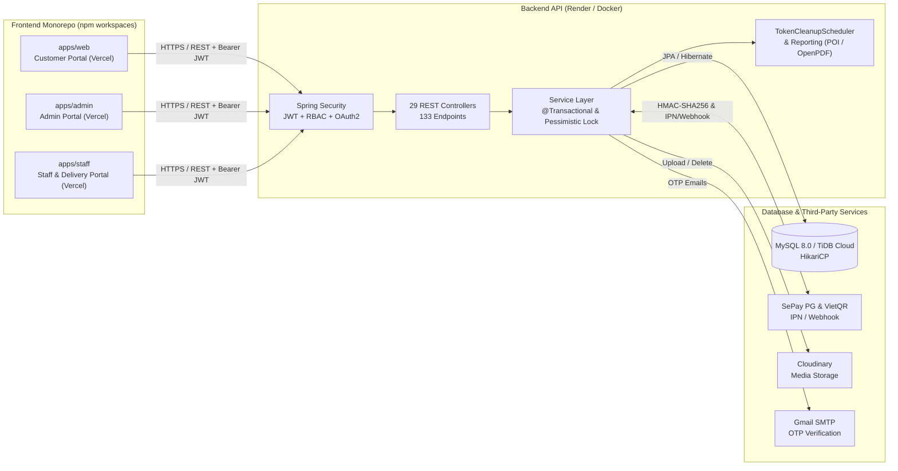
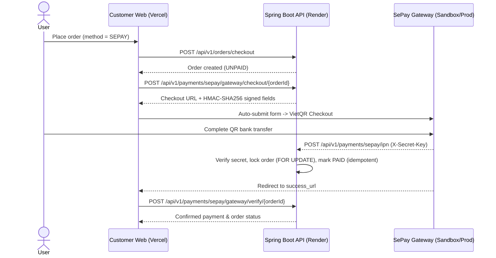

# ThunderFood — Food Ordering & Delivery Platform

<p align="center">
  <strong>A full-stack food ordering, delivery packaging, and online payment platform built with Spring Boot, React TypeScript Monorepo, MySQL/TiDB Cloud, and SePay Payment Gateway.</strong>
</p>

<p align="center">
  <a href="https://thunderfoods.vercel.app/"></a>
  <a href="https://thunderfoods-staff.vercel.app/"></a>
  <a href="https://thunderfoods-admin.vercel.app/"></a>
  <a href="https://thunderfood-backend.onrender.com/swagger-ui.html"></a>
  
  
  
  
</p>

---

## Live Deployment

| Component | Role / Scope | Platform | URL |
| :--- | :--- | :--- | :--- |
| **Customer Storefront** (`apps/web`) | `CUSTOMER` | Vercel | https://thunderfoods.vercel.app/ |
| **Staff & Delivery Portal** (`apps/staff`) | `STAFF` | Vercel | https://thunderfoods-staff.vercel.app/ |
| **Admin Management Portal** (`apps/admin`) | `ADMIN` | Vercel | https://thunderfoods-admin.vercel.app/ |
| **Backend REST API** | All roles & Webhooks | Render (Docker) | https://thunderfood-backend.onrender.com |
| **OpenAPI / Swagger UI** | API Documentation | Render | https://thunderfood-backend.onrender.com/swagger-ui.html |
| **Health Check** | Service Status | Render | https://thunderfood-backend.onrender.com/api/v1/health |

> **Note:** The backend runs on Render's free tier, so the first request after inactivity may take ~30–50 seconds to wake up.

---

## Overview & Engineering Highlights

ThunderFood is designed as a production-oriented **client-service** platform separating **Customer**, **Staff/Shipper**, and **Admin** operations into dedicated frontends backed by a single layered Spring Boot API:

- **Scale & Architecture:** **22 JPA entities**, **29 REST controllers**, and **133 API endpoints** structured cleanly into Controller -> Service -> Repository -> Entity/DTO layers with centralized `GlobalExceptionHandler` and standardized `ApiResponse`.
- **Security & RBAC:** Stateless **JWT authentication** (Access + Refresh Token with unique `jti` and database-backed revocation), **Google OAuth2** login, BCrypt password hashing, email OTP verification, and strict role guards (`CUSTOMER`, `STAFF`, `ADMIN`).
- **Online Payment (SePay Payment Gateway & VietQR):** End-to-end payment integration supporting signed checkout initialization (**HMAC-SHA256**), **IPN & Webhook** handling with constant-time secret verification (`MessageDigest.isEqual`), server-side transaction reconciliation, and idempotent payment confirmation.
- **Concurrency & ACID Safety:** `@Transactional` workflows combined with native **Pessimistic Locking (`SELECT ... FOR UPDATE`)** to prevent race conditions during inventory deduction, delivery package claiming, and payment status updates.
- **Automated Quality & Delivery:** **45 backend test suites / 298 test cases (100% passing)** covering Controller, Service, Utility unit tests and **6 full-stack integration tests** (`@SpringBootTest` + `MockMvc` + H2 MySQL mode), plus **12 frontend Vitest suites** with MSW.
- **CI/CD & Containerization:** Automated test pipelines on GitHub Actions, Docker image builds pushed to **GitHub Container Registry (`ghcr.io`)**, and automated deployment to **Render** and **Vercel**.

---

## System Architecture



---

## Key Features by Role

### 1. Customer Portal (`apps/web`)
- **Discovery & Search:** Browse categories, banners, and menu items with multi-criteria filtering (keyword with Vietnamese IME-safe debounce, price range, rating, discount, sorting, and pagination).
- **Cart & Smart Checkout:** Manage cart items, shipping addresses with **ward-based delivery fee calculation** (`ServiceWard`), stackable **multi-type vouchers** (product discount & shipping discount with eligibility preview), and wishlist.
- **Payments:** Support for **COD** and **SePay Online Payment (`BANK_TRANSFER` / VietQR)** with real-time order verification, payment history page, and automated invoice/payment tracking.
- **Account & Engagement:** Registration with OTP email verification, Google Sign-In, order lifecycle tracking, cancellation (blocked once `PAID`), notifications, and product reviews.

### 2. Staff & Delivery Portal (`apps/staff`)
- **Order Processing:** Filter incoming orders by district/ward and status (`PENDING`, `CONFIRMED`, `DELIVERING`, `DELIVERED`).
- **DeliveryPackage Workflow:** Confirm orders into `DeliveryPackage` batches, claim packages for delivery with pessimistic locking (`FOR UPDATE`), and mark orders as delivered (automatically updating COD payment status to `PAID` and completing packages).
- **Customer Interaction:** View and reply to customer product reviews.

### 3. Admin Portal (`apps/admin`)
- **Dashboard & Analytics:** Revenue, order metrics, and operational summaries.
- **Catalog & Operations Management:** Full CRUD for products (with soft-delete and cart cleanup), categories, banners, vouchers, service wards, users, staff accounts, and system settings.
- **Report Exports:** Generate and download **Excel (`.xlsx`)** via **Apache POI** and **PDF** reports via **OpenPDF**.

---

## SePay Payment Flow (Checkout + IPN + Reconciliation)



---

## Tech Stack

| Layer | Technologies |
| :--- | :--- |
| **Backend** | Java 21, Spring Boot 4.1.1, Spring Web, Spring Security, Spring Data JPA / Hibernate, Spring Validation, Spring Mail, HikariCP |
| **Database** | MySQL 8.0 / TiDB Cloud (Production), H2 `MODE=MySQL` (Integration Tests), SQL migration scripts (`V1`, `V2`) |
| **Auth & Payments** | JWT (`jjwt` 0.11.5), Google OAuth2, SePay Payment Gateway (`BANK_TRANSFER` / VietQR, HMAC-SHA256, IPN & Webhook) |
| **Integrations & Utilities** | Cloudinary SDK, Gmail SMTP, Apache POI (`poi-ooxml`), OpenPDF, SpringDoc OpenAPI 3, Lombok |
| **Frontend Monorepo** | React 18, TypeScript, Vite, TailwindCSS 4, TanStack React Query, Zustand, React Router DOM 7, React Hook Form + Zod, Axios, Swiper, Lucide |
| **Testing** | JUnit 5, Mockito, MockMvc, `@SpringBootTest`, Vitest, React Testing Library, MSW, Oxlint |
| **DevOps & Hosting** | Docker (multi-stage builds + Nginx), Docker Compose, GitHub Actions CI/CD, GHCR (`ghcr.io`), Render, Vercel |

---

## Repository Structure

```text
ThunderFood/
├── .github/workflows/          # CI/CD pipelines (backend-ci, frontend-ci, backend_deploy, deploy-frontend)
├── backend_thunderfood/        # Spring Boot backend API
│   ├── src/main/java/.../
│   │   ├── config/             # SecurityConfig, JWT filters, CORS, OpenAPI, DataInitializer
│   │   ├── controller/         # 29 REST controllers (Auth, Customer, Staff, Admin, Payment, Report)
│   │   ├── dto/                # Request/Response DTOs with Bean Validation
│   │   ├── entity/             # 22 JPA entities
│   │   ├── repository/         # Spring Data JPA + JpaSpecificationExecutor + native FOR UPDATE queries
│   │   ├── scheduler/          # TokenCleanupScheduler (expired tokens & OTP cleanup)
│   │   └── service/            # Business logic implementations
│   ├── src/main/resources/
│   │   ├── application.yaml    # Spring Boot, HikariCP, SePay, JWT, Mail, Cloudinary config
│   │   └── db/migration/       # V1__init_schema.sql, V2__delivery_and_packaging.sql
│   ├── src/test/               # 45 test suites (298 tests)
│   ├── Dockerfile              # Multi-stage Maven + Temurin 21 JRE image
│   └── .env.example            # Environment variable template
├── frontend/                   # npm workspaces monorepo
│   ├── apps/
│   │   ├── web/                # Customer storefront (Vercel / Docker port 3008)
│   │   ├── admin/              # Admin portal (Vercel / Docker port 3009)
│   │   └── staff/              # Staff & delivery portal (Vercel / Docker port 3010)
│   ├── packages/               # Shared packages: @thunderfood/api, config, types, ui
│   ├── Dockerfile              # Multi-app frontend build served by Nginx
│   └── nginx.conf
└── docker-compose.yml          # Full-stack local/server orchestration
```

---

## Testing & Quality Assurance

Backend test suite (`mvn test` on profile `test` with H2 `MODE=MySQL`):

| Category | Suites | Test Cases | Coverage Focus |
| :--- | :---: | :---: | :--- |
| Application Context | 1 | 1 | Spring Boot startup & HikariCP initialization |
| End-to-End Integration Tests | 6 | 8 | Auth/RBAC, Specification search/pagination, Checkout + Voucher + Stock rollback, Staff `DeliveryPackage` workflow, Admin soft-delete + Dashboard, SePay PG & Webhook/IPN security |
| Controller Unit Tests (`@WebMvcTest` / MockMvc) | 21 | 111 | Request routing, validation (`@Valid`), HTTP status codes, role guards |
| Service Unit Tests (Mockito) | 15 | 173 | Business rules, exception handling, scheduler & service edge cases |
| Utility Unit Tests | 2 | 5 | Slug generation, formatting helpers |
| **Total** | **45** | **298** | **0 Failures, 0 Errors, 0 Skipped** |

Frontend also includes **12 Vitest suites** across `apps/web` and `apps/admin` executed automatically in GitHub Actions (`frontend-ci.yml`).

---

## Local Setup

### Prerequisites
- Java 21+, Maven (or `./mvnw`)
- Node.js 20+
- MySQL 8.0+ (or Docker)

### 1. Configure Environment Variables
Copy the template to `.env` at the repository root and fill in your credentials:
```bash
cp backend_thunderfood/.env.example .env
```

Key variables include:
- Database: `SPRING_DATASOURCE_URL`, `SPRING_DATASOURCE_USERNAME`, `SPRING_DATASOURCE_PASSWORD`
- Auth & Frontend: `JWT_SECRET`, `APP_FRONTEND_URL`, `GOOGLE_CLIENT_ID`
- Mail & Media: `MAIL_USERNAME`, `MAIL_PASSWORD`, `CLOUDINARY_CLOUD_NAME`, `CLOUDINARY_API_KEY`, `CLOUDINARY_API_SECRET`
- SePay: `SEPAY_MERCHANT_ID`, `SEPAY_SECRET_KEY`, `SEPAY_BANK_CODE`, `SEPAY_ACCOUNT_NUMBER`, `SEPAY_ACCOUNT_NAME`, `SEPAY_WEBHOOK_API_KEY`

### 2. Run Backend
```bash
cd backend_thunderfood
./mvnw spring-boot:run
```
Swagger UI will be available at `http://localhost:8080/swagger-ui.html`.

Run all backend tests (uses in-memory H2 in MySQL mode, no local MySQL required):
```bash
cd backend_thunderfood
./mvnw test
```

### 3. Run Frontend Monorepo
```bash
cd frontend
npm install
npm run dev --workspace=@thunderfood/web
```

### 4. Run with Docker Compose
```bash
docker compose up --build
```
- Backend API: `http://localhost:8080`
- Customer Web: `http://localhost:3008`
- Admin Portal: `http://localhost:3009`
- Staff Portal: `http://localhost:3010`

---

## Author

**Trần Huy Sơn** — Java Backend Developer & Team Leader  
- GitHub: [@Smagic205](https://github.com/Smagic205)
- Email: `sont20082005@gmail.com`
