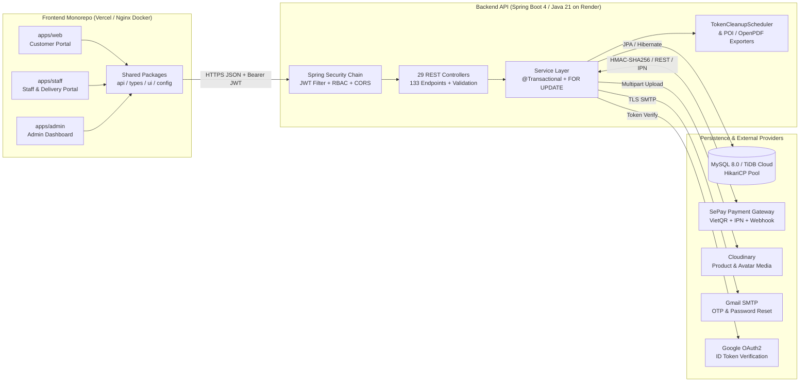
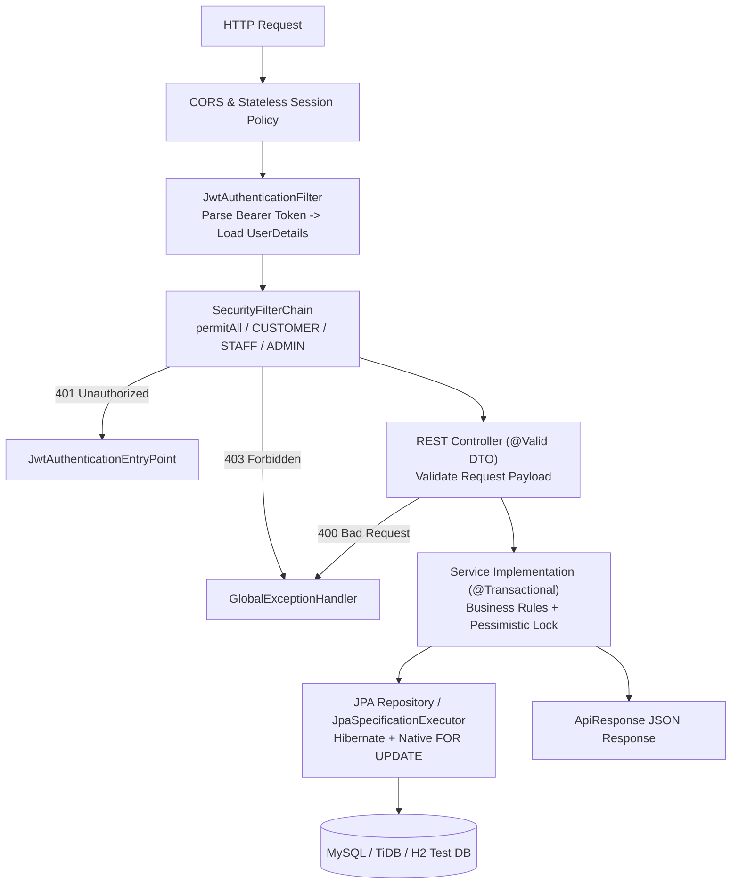
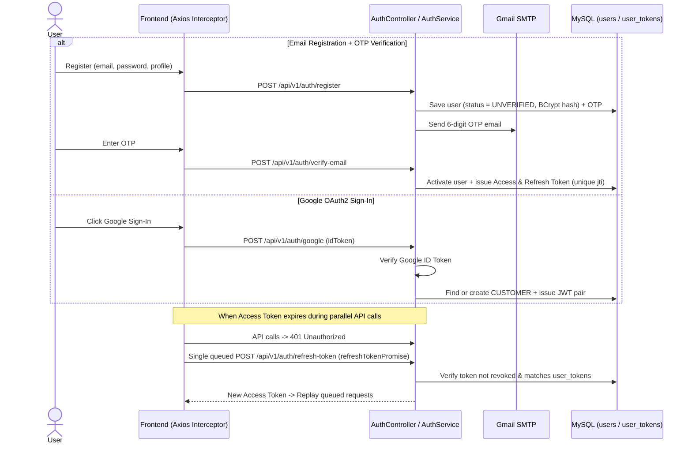
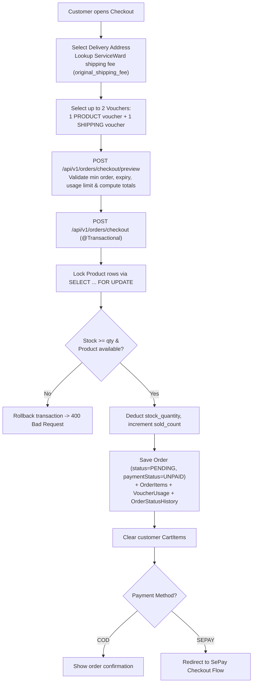
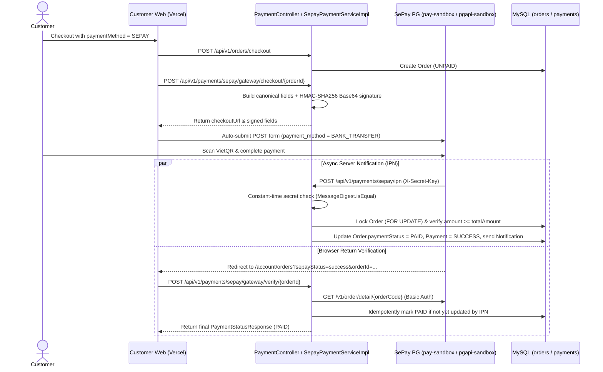
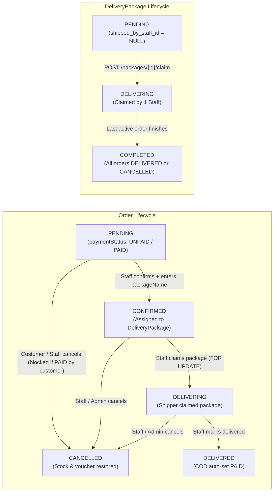
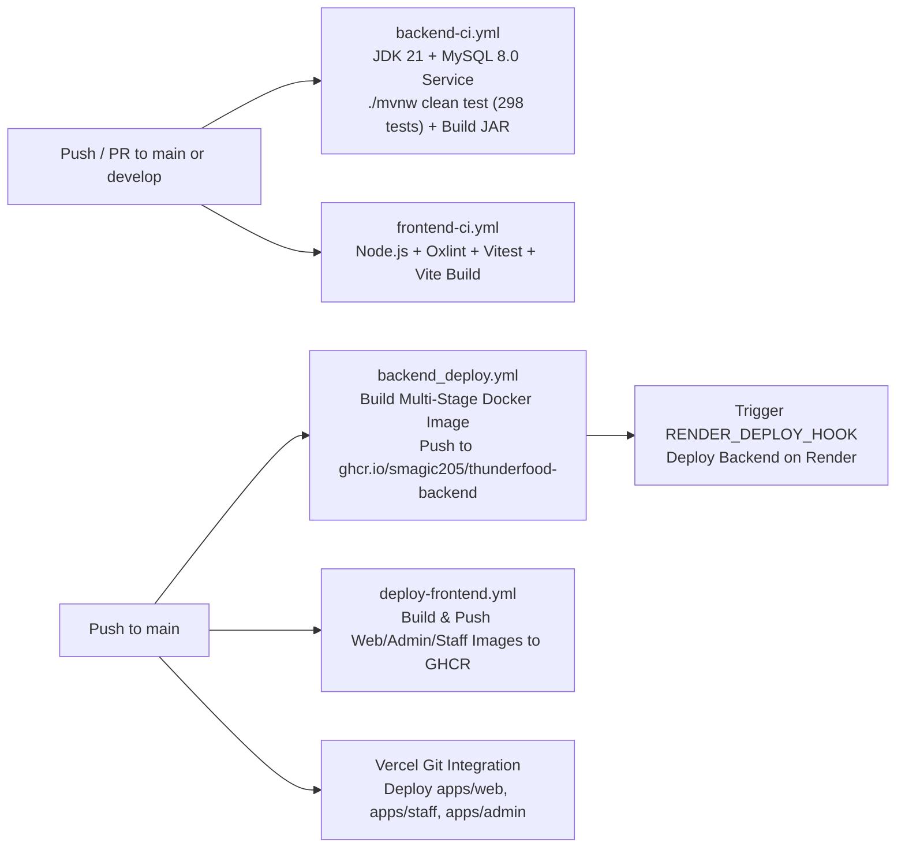

# ThunderFood — Food Ordering & Delivery Platform

<p align="center">
  <strong>A production-oriented, multi-role food ordering, delivery packaging, and online payment platform built with Spring Boot, React TypeScript Monorepo, MySQL/TiDB Cloud, and SePay Payment Gateway.</strong>
</p>

<p align="center">
  <a href="https://thunderfoods.vercel.app/"></a>
  <a href="https://thunderfoods-staff.vercel.app/"></a>
  <a href="https://thunderfoods-admin.vercel.app/"></a>
  <a href="https://thunderfood-backend.onrender.com/swagger-ui.html"></a>
  
  
  
  
</p>

---

## Table of Contents

1. [Live Deployment](#live-deployment)
2. [Platform Overview](#platform-overview)
3. [System Architecture](#system-architecture)
4. [Backend Layered Request Lifecycle](#backend-layered-request-lifecycle)
5. [Core Business Flows](#core-business-flows)
   - [Authentication, OTP, Google OAuth2 & Token Refresh](#1-authentication-otp-google-oauth2--token-refresh)
   - [Smart Checkout, Dual-Voucher Engine & Stock Locking](#2-smart-checkout-dual-voucher-engine--stock-locking)
   - [SePay Online Payment, IPN & Reconciliation Flow](#3-sepay-online-payment-ipn--reconciliation-flow)
   - [Order & DeliveryPackage State Machine](#4-order--deliverypackage-state-machine)
6. [Database Domain Model (22 JPA Entities)](#database-domain-model-22-jpa-entities)
7. [Frontend Monorepo & Portal Routes](#frontend-monorepo--portal-routes)
8. [Backend API Modules (29 Controllers / 133 Endpoints)](#backend-api-modules-29-controllers--133-endpoints)
9. [CI/CD & Deployment Pipeline](#cicd--deployment-pipeline)
10. [Testing & Quality Assurance](#testing--quality-assurance)
11. [Tech Stack](#tech-stack)
12. [Local Development & Docker Setup](#local-development--docker-setup)

---

## Live Deployment

| Component | Target Role | Platform | URL |
| :--- | :--- | :--- | :--- |
| **Customer Storefront** (`apps/web`) | `CUSTOMER` | Vercel | https://thunderfoods.vercel.app/ |
| **Staff & Delivery Portal** (`apps/staff`) | `STAFF` | Vercel | https://thunderfoods-staff.vercel.app/ |
| **Admin Management Portal** (`apps/admin`) | `ADMIN` | Vercel | https://thunderfoods-admin.vercel.app/ |
| **Backend REST API** | All roles & Webhooks | Render (Docker) | https://thunderfood-backend.onrender.com |
| **OpenAPI / Swagger UI** | Interactive API Docs | Render | https://thunderfood-backend.onrender.com/swagger-ui.html |
| **Health Check** | Service Probe | Render | https://thunderfood-backend.onrender.com/api/v1/health |

> **Note:** The backend runs on Render's free tier, so the first request after an idle period may take ~30–50 seconds for container cold start.

---

## Platform Overview

ThunderFood models a real-world food ordering and last-mile delivery operation with **three role-specific frontend applications** sharing common workspace packages and communicating with a single **Spring Boot 4 REST API**.

### Key Engineering Decisions
- **Role-Isolated Frontend Monorepo (`npm workspaces`):** Instead of bundling Customer, Staff, and Admin UIs into one heavy bundle, each portal (`apps/web`, `apps/staff`, `apps/admin`) is an independent Vite + React 18 SPA sharing reusable code via `@thunderfood/api`, `@thunderfood/types`, `@thunderfood/ui`, and `@thunderfood/config`.
- **Stateless Security + Token Revocation:** JWT Access & Refresh Tokens include a unique `jti` (`UUID`), persisted in `user_tokens` so logout immediately revokes refresh capability, while `TokenCleanupScheduler` periodically purges expired tokens/OTPs.
- **Race-Condition Prevention:** Native SQL Pessimistic Locking (`SELECT ... FOR UPDATE`) guards critical concurrent operations: deducting product stock during checkout, claiming a `DeliveryPackage` by a shipper, and confirming SePay payments.
- **Stackable Dual-Voucher Pricing:** Customers can preview and combine at most **one `PRODUCT` voucher** (discounting item subtotal) and **one `SHIPPING` voucher** (discounting ward-based delivery fee) in a single order, with usage tracking (`voucher_usages`) and automatic rollback on cancellation.
- **Last-Mile `DeliveryPackage` Batching:** Staff confirm `PENDING` orders directly into named delivery batches (`DeliveryPackage`, bounded by `MAX_ORDERS_PER_PACKAGE`), claim an entire batch to deliver, and mark individual orders as `DELIVERED`—automatically marking COD orders `PAID` and completing the package once all orders finish.
- **Verified SePay Online Payment:** Integrates SePay Payment Gateway (`BANK_TRANSFER` / VietQR) with **HMAC-SHA256** field signing, constant-time `MessageDigest.isEqual` verification on both IPN (`X-Secret-Key`) and Bank Hub Webhook (`Authorization: Apikey`), active order-detail verification against SePay PG API, and idempotent state updates.

---

## System Architecture



---

## Backend Layered Request Lifecycle

Every API call passes through a strict layered pipeline enforcing authentication, validation, transactional integrity, and uniform error responses (`ApiResponse<T>`):



---

## Core Business Flows

### 1. Authentication, OTP, Google OAuth2 & Token Refresh

- Accounts created via standard registration start as `UNVERIFIED` until a 6-digit email OTP is verified.
- Disabled/unverified/locked logins are explicitly mapped from Spring Security `DisabledException` / `LockedException` into `AccessDeniedException` (HTTP `403`) so the frontend prompts OTP re-verification cleanly.
- On the frontend (`axiosClient.ts`), concurrent `401` responses share a single `refreshTokenPromise` lock so `/api/v1/auth/refresh-token` is never called multiple times simultaneously.



---

### 2. Smart Checkout, Dual-Voucher Engine & Stock Locking



---

### 3. SePay Online Payment, IPN & Reconciliation Flow

Supports both **SePay Payment Gateway (`BANK_TRANSFER` / VietQR redirect)** and **SePay Bank Hub Webhook** (for direct bank transfer notifications), with customer order self-cancellation automatically blocked once `paymentStatus == "PAID"`.



---

### 4. Order & `DeliveryPackage` State Machine

Staff organize confirmed orders into **`DeliveryPackage`** batches (capped by `MAX_ORDERS_PER_PACKAGE`, default `7` from `system_settings`). The package status is derived from the orders inside it.



---

## Database Domain Model (22 JPA Entities)

Managed via JPA/Hibernate with relational schema scripts ([V1__init_schema.sql](backend_thunderfood/src/main/resources/db/migration/V1__init_schema.sql) and [V2__delivery_and_packaging.sql](backend_thunderfood/src/main/resources/db/migration/V2__delivery_and_packaging.sql)) and HikariCP (`ThunderFoodHikariPool`):

| Domain | Entities | Purpose |
| :--- | :--- | :--- |
| **Users & Auth** | `User`, `Role`, `UserToken`, `Address`, `ServiceWard` | Multi-role accounts (`user_roles`), refresh/OTP token storage, Hanoi ward-based delivery zones & shipping fees |
| **Catalog & Storefront** | `Category`, `Product`, `ProductImage`, `Banner`, `Wishlist` | Categorized menu, multi-image gallery, discount/pricing metadata, promotional banners, customer favorites |
| **Cart & Promotions** | `Cart`, `CartItem`, `Voucher`, `VoucherUsage` | Persistent shopping cart, `PRODUCT` and `SHIPPING` voucher types, per-user & global redemption limits |
| **Orders & Delivery** | `Order`, `OrderItem`, `OrderStatusHistory`, `DeliveryPackage` | Order snapshots, dual voucher foreign keys, audit trail of status transitions, staff delivery batching |
| **Payments, Reviews & Config** | `Payment`, `Review`, `Notification`, `SystemSetting` | SePay transaction logs & raw IPN/Webhook payloads, ratings + staff replies, in-app notifications, dynamic runtime settings |

---

## Frontend Monorepo & Portal Routes

Located inside `frontend/`, structured as an `npm workspaces` monorepo:

```text
frontend/
├── apps/
│   ├── web/        # Customer Storefront (https://thunderfoods.vercel.app/)
│   ├── staff/      # Staff & Delivery Portal (https://thunderfoods-staff.vercel.app/)
│   └── admin/      # Admin Management Portal (https://thunderfoods-admin.vercel.app/)
└── packages/
    ├── api/        # Shared Axios client, token refresh queue & API helpers
    ├── types/      # Shared TypeScript interfaces & domain types
    ├── ui/         # Shared UI components
    └── config/     # Shared ESLint/TypeScript/Tailwind configuration
```

| App | Key Routes | Highlights |
| :--- | :--- | :--- |
| **Customer (`apps/web`)** | `/`, `/menu`, `/product/:slug`, `/vouchers`, `/support`, `/cart`, `/checkout`, `/account/{profile,addresses,orders,payments,wishlist,notifications}`, `/login`, `/register`, `/forgot`, `/verify-email` | Code-split lazy routes, IME-safe search debounce, React Hook Form + Zod validation, direct SePay checkout redirect & payment history |
| **Staff (`apps/staff`)** | `/login`, `/orders`, `/packages`, `/my-package`, `/reviews`, `/notifications` | Ward/status order filtering, package creation/claiming workflow, active delivery checklist, review replies |
| **Admin (`apps/admin`)** | `/login`, `/admin`, `/admin/{orders,packages,products,categories,customers,staffs,reviews,notifications,vouchers,banners,settings}` | Revenue & KPI dashboard, full catalog/user/staff/ward/voucher CRUD, Cloudinary image upload, Excel & PDF export |

---

## Backend API Modules (29 Controllers / 133 Endpoints)

All endpoints follow `/api/v1/...` with interactive schemas exposed at `/swagger-ui.html`.

| Module | Controllers | Endpoints | Key Capabilities |
| :--- | :--- | :---: | :--- |
| **Auth & Account** | `AuthController`, `UserController`, `AddressController` | 26 | Register, OTP verify, Login (Customer & Staff), Google OAuth2, Refresh/Logout, Forgot/Reset Password, Profile/Avatar, Addresses & Wards |
| **Public Storefront** | `ProductController`, `CategoryController`, `BannerController`, `VoucherController`, `HealthCheckController` | 10 | Dynamic multi-filter product search (`JpaSpecificationExecutor`), category tree, banners, active vouchers, health check |
| **Customer Shopping** | `CartController`, `OrderController`, `WishlistController`, `ReviewController`, `NotificationController` | 22 | Cart CRUD, checkout preview & placement, order tracking & cancellation, wishlist, product reviews, notifications |
| **SePay Payments** | `PaymentController` | 8 | SePay PG Checkout signing (`/sepay/gateway/checkout/{orderId}`), PG order verification, IPN (`/sepay/ipn`), Bank Hub Webhook (`/sepay/webhook`), VietQR info, sandbox simulation, payment status & history |
| **Staff Operations** | `StaffOrderController`, `StaffReviewController` | 15 | Filter orders by ward/status, confirm & assign to `DeliveryPackage`, claim/deliver/cancel orders, reply to reviews |
| **Admin Management** | `AdminDashboardController`, `AdminOrderController`, `AdminPackageController`, `AdminProductController`, `AdminCategoryController`, `AdminBannerController`, `AdminVoucherController`, `AdminServiceWardController`, `AdminUserController`, `AdminStaffController`, `AdminSettingController`, `AdminUploadController`, `AdminReportController` | 52 | KPIs & charts, order & package oversight, soft-delete products (with cart cleanup), staff creation, Cloudinary uploads, **Excel (`.xlsx`) & PDF** report export |

---

## CI/CD & Deployment Pipeline

Configured in `.github/workflows/`:



---

## Testing & Quality Assurance

Verified with `mvn -o test` (JDK 22 targeting Java 21, Spring Boot `test` profile with H2 in `MODE=MySQL` and `ThunderFoodTestHikariPool`):

| Layer | Test Suites | Test Cases | What Is Verified |
| :--- | :---: | :---: | :--- |
| **Application Context** | 1 | 1 | Full Spring Boot context & HikariCP startup |
| **End-to-End Integration Tests** | 6 | 8 | Full `SecurityFilterChain -> JWT -> @Transactional Service -> JPA/H2` flows:<br/>• `IT-01` Auth, OTP activation, BCrypt, RBAC & refresh revocation<br/>• `IT-02` Multi-filter `Specification` search, sort & pagination<br/>• `IT-03` Cart checkout, dual vouchers, stock deduction & cancel rollback<br/>• `IT-04` Staff `DeliveryPackage` confirm -> claim -> deliver -> COD `PAID`<br/>• `IT-05` Admin `@Valid`, product soft-delete cart cleanup & dashboard KPIs<br/>• `IT-06`–`IT-08` SePay QR, HMAC checkout signing, IPN/Webhook auth & idempotency |
| **Controller Unit Tests** | 21 | 111 | `@WebMvcTest` / MockMvc validation, routing, HTTP status codes & RBAC |
| **Service Unit Tests** | 15 | 173 | Mockito unit coverage across business services & `TokenCleanupScheduler` |
| **Utility Unit Tests** | 2 | 5 | Slug generation & number formatting helpers |
| **Total (Backend)** | **45** | **298** | **0 Failures, 0 Errors, 0 Skipped (`BUILD SUCCESS`)** |

Additionally, the frontend includes **12 Vitest suites** (`1` in `apps/admin`, `11` in `apps/web` using React Testing Library & MSW) executed via `frontend-ci.yml`. See [TEST_REPORT.md](backend_thunderfood/TEST_REPORT.md) for detailed bug logs and integration test diagnostics.

---

## Tech Stack

| Category | Technologies |
| :--- | :--- |
| **Backend Core** | Java 21, Spring Boot 4.1.1, Spring Web, Spring Security, Spring Data JPA / Hibernate, Spring Validation, Spring Mail, HikariCP |
| **Database** | MySQL 8.0 / TiDB Cloud (Production), H2 `MODE=MySQL` (Integration Tests), SQL Migration Scripts (`V1`, `V2`) |
| **Auth & Payments** | JWT (`jjwt` 0.11.5), Google OAuth2, SePay Payment Gateway (`BANK_TRANSFER` / VietQR, HMAC-SHA256, IPN & Bank Hub Webhook) |
| **Storage, Email & Reports** | Cloudinary SDK (`cloudinary-http44`), Gmail SMTP, Apache POI (`poi-ooxml`), OpenPDF, SpringDoc OpenAPI 3, Lombok |
| **Frontend Monorepo** | React 18, TypeScript, Vite, TailwindCSS 4, TanStack React Query, Zustand, React Router DOM 7, React Hook Form + Zod, Axios, Swiper, Lucide |
| **Testing** | JUnit 5, Mockito, MockMvc, `@SpringBootTest`, Vitest, React Testing Library, MSW, Oxlint |
| **DevOps & Hosting** | Docker (Multi-stage Maven/JRE & Nginx builds), Docker Compose, GitHub Actions, GHCR (`ghcr.io`), Render, Vercel |

---

## Local Development & Docker Setup

### Prerequisites
- **Java 21+** and Maven (or bundled `./mvnw`)
- **Node.js 20+** and `npm`
- **MySQL 8.0+** (or Docker Desktop)

### 1. Configure Environment Variables
Create a `.env` file at the repository root from the template (never commit `.env`):
```bash
cp backend_thunderfood/.env.example .env
```

Main variables:
- **Database:** `SPRING_DATASOURCE_URL`, `SPRING_DATASOURCE_USERNAME`, `SPRING_DATASOURCE_PASSWORD`
- **Security & Frontend:** `JWT_SECRET`, `APP_FRONTEND_URL`, `GOOGLE_CLIENT_ID`
- **Mail & Media:** `MAIL_USERNAME`, `MAIL_PASSWORD`, `CLOUDINARY_CLOUD_NAME`, `CLOUDINARY_API_KEY`, `CLOUDINARY_API_SECRET`
- **SePay Payment Gateway:** `SEPAY_ENABLED`, `SEPAY_SANDBOX`, `SEPAY_MERCHANT_ID`, `SEPAY_SECRET_KEY`, `SEPAY_CHECKOUT_URL`, `SEPAY_PG_API_URL`, `SEPAY_PG_PAYMENT_METHOD`, `SEPAY_BANK_CODE`, `SEPAY_ACCOUNT_NUMBER`, `SEPAY_ACCOUNT_NAME`, `SEPAY_WEBHOOK_API_KEY`

### 2. Run Backend Locally
```bash
cd backend_thunderfood
./mvnw spring-boot:run
```
- API base URL: `http://localhost:8080/api/v1`
- Swagger UI: `http://localhost:8080/swagger-ui.html`

Run all 298 backend tests locally (uses in-memory H2, no external MySQL needed):
```bash
cd backend_thunderfood
./mvnw test
```

### 3. Run Frontend Monorepo Locally
```bash
cd frontend
npm install

# Run Customer Web / Staff Portal / Admin Portal
npm run dev --workspace=@thunderfood/web
npm run dev --workspace=@thunderfood/staff
npm run dev --workspace=@thunderfood/admin
```

### 4. Run Full Stack with Docker Compose
```bash
docker compose up --build
```
- **Backend API:** `http://localhost:8080`
- **Customer Web:** `http://localhost:3008`
- **Admin Portal:** `http://localhost:3009`
- **Staff Portal:** `http://localhost:3010`

---

## Author

**Trần Huy Sơn** — Java Backend Developer & Team Leader  
- **GitHub:** [@Smagic205](https://github.com/Smagic205)
- **Email:** `sont20082005@gmail.com`
